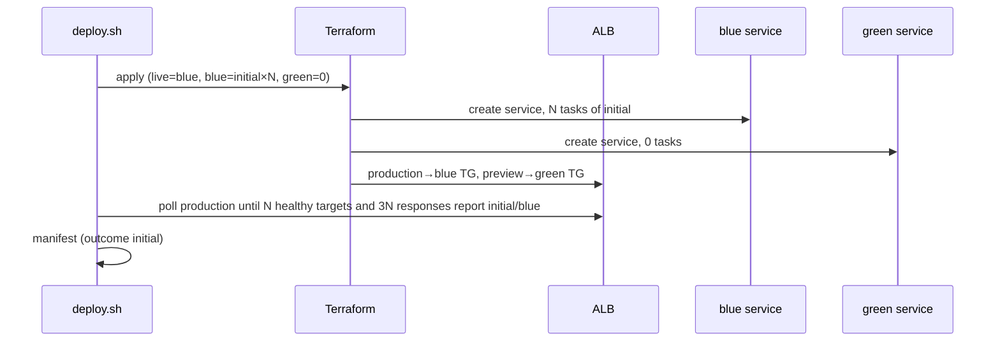
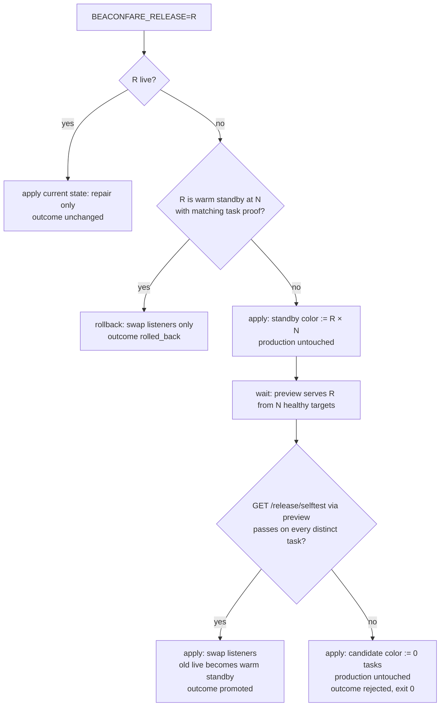
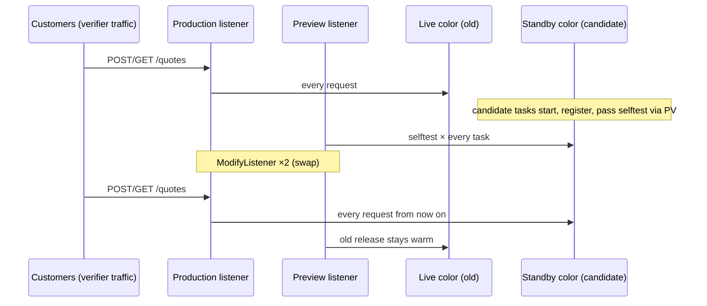

# BeaconFare Release Cutover — Reasoning

## Introduction

BeaconFare prices freight lanes and stores every issued quote. The product
problem is not the API; it is **shipping a new release of it safely**. A
previous release with a rounding regression reached customers because it
was perfectly healthy. The platform the model builds must therefore:

- stage every candidate release next to production, on real infrastructure;
- prove it through a **preview listener** before any customer request reaches it;
- switch customers over without failing a single request;
- keep the previous release warm so a rollback is a listener change;
- reject a candidate that fails its proof, automatically, with production untouched.

Three images are supplied, one per release (3.4.0, 3.5.0, 3.6.0). The
version and pricing build are baked in at build time, so nothing in a task
definition can alter them. The runtime picks, per environment, which of
3.5.0 and 3.6.0 is built with the `legacy_floor` pricing regression. The
model sees the choice in its own environment only by running the self-test;
the verifier makes a fresh choice, so hard coding "3.6.0 is bad" fails half
the time and skipping verification fails always.

The application exists to make the release mechanics observable. Every
response carries `X-BeaconFare-Version`, `X-BeaconFare-Color` and
`X-BeaconFare-Task`, so the verifier can say exactly which release, color and
task answered each production request during a release. `GET
/release/selftest` prices four reference lanes and round-trips a probe item
through DynamoDB; the defective build fails it while `/health/ready` stays
`200`. That gap between *healthy* and *correct* is the core of the task.

The model writes `infra/*.tf`, a `deploy.sh` that acts as a release
controller driven by `BEACONFARE_RELEASE`, a `destroy.sh`, and a manifest.

## Infrastructure Used

| Service | Job in this system | What connects to it |
|---|---|---|
| **VPC** (2 public, 2 private subnets, IGW, route tables, security groups) | Public ALB subnets and private task subnets. SGs are declared (ALB admits both listener ports; tasks admit 8080 from the ALB SG only) but not enforced by the emulator, so they are checked as declarations. | ALB, both ECS services |
| **Application Load Balancer** | One internet-facing ALB with two listeners. **Production** forwards to the live color, **preview** to the standby color. Promotion and rollback are in-place listener modifications that swap the two. | Clients, verifier, `deploy.sh` (self-test via preview) |
| **Target groups** (blue, green) | One `ip` target group per color on 8080 with `/health/ready`. Target health tells the controller when a color's tasks are registered and ready. | ALB listeners, ECS services |
| **ECS cluster + two Fargate services** | The blue and green colors. Each runs one release at a time, selected by task definition, at `api_desired_count` or `0` tasks depending on the release state. Tasks set `DEPLOYMENT_COLOR`. | Target groups, DynamoDB |
| **ECS task definitions** | One per color × release. The emulator does not echo container definitions back, so they sit under `ignore_changes`; a release therefore selects its own definition instead of mutating one. | ECS services |
| **DynamoDB** (quotes table, TTL on `expires_at`) | Durable store shared by both colors and every release. Proves quotes written during a cutover survive it and that the self-test's storage round trip works. | Every task |
| **IAM** (execution role, task role) | Execution role ships logs only; one task role for every release with four DynamoDB actions on the quotes table only. Declaration-checked. | ECS task definitions |
| **CloudWatch Logs** | One `/ecs/<family>` group per task definition family with the configured retention. The endpoint always writes container output there and auto-creates the group if missing, so an unmanaged one leaks past destroy. | ECS task definitions |

Emulator facts the design rests on (all published in `runtime.md`):
Terraform updates to an existing service's `desired_count` are not applied
(created counts and CLI `update-service --desired-count` are), so capacity
belongs to the release controller while Terraform owns everything else —
the same split real teams use when something outside Terraform scales a
service;
ECS deployments are simplified — no circuit breaker, no min/max percent, no
automatic rollback — so the safety net has to be built by the model, not
configured; each listener port is its own socket on the endpoint host;
container definitions are not read back in the registered shape.

## Operational Flows

### 1. First deployment

### 2. Candidate release: verify, then promote or reject

### 3. Production during a promotion

### 4. Rollback and repair

Rollback is flow 2's middle branch: the listeners swap back onto the tasks
that were already running, but only after independently sampling exactly the
task identities in their durable preview proof. The verifier proves both the
task-ARN reuse and the evidence match. If an operator restarts a warm service
at the same release and desired count, a no-release reconciliation clears the
stale proof; a request then uses the candidate path to self-test those new
warm tasks before promotion. Repair deletes the preview listener and the
standby ECS service; a `deploy.sh` run with no release requested re-applies
the recorded state, which recreates both without touching the live service or
the production listener.

### 5. State

The cloud record holds `live_color`, `color_release`, `color_count`, global
release history and a per-color proof of the exact task identities that
self-tested. `infra/release.auto.tfvars.json` is the local cache auto-loaded
by Terraform so a standalone `plan -refresh=false` agrees with the last run.
Leftover release state without Terraform state (from the agent's own testing)
is discarded on the first verifier run.

## Score

Twenty obligations, 100 points. Only 100 passes.

### v0.16.0: a fresh worker must not re-bless replaced warm tasks

A missing proof after a worker handoff is recoverable: an intact preview
standby can be independently sampled and recorded again. A nonempty proof
with different task identities is a different state—it proves those warm
tasks were externally replaced. Version 25 makes this safety distinction
explicit and executable by restarting the warm standby, discarding the worker,
then requiring the replacement worker to clear the stale proof. A later
request must take candidate verification and report `promoted`, never use a
fresh-worker shortcut to roll back onto unproven replacement tasks.

This is a reproducible composition of the existing record and current-task
proof contracts. It preserves the legitimate recovery path for absent proof,
but prevents an implementation from treating every proof mismatch as cache
loss. The verifier samples actual task identities and checks traffic, task
reuse, record history, outcome, and fresh proof deterministically.

### v0.15.0: operator directives survive a worker handoff

The record is publicly the source of truth both after a worker handoff and
after an operator edit, but the executable scenarios had exercised those
rules independently. A controller could pass by applying an operator edit
only while its preceding local cache remained available. Version 24 composes
the two normal operating conditions: the operator changes `live_color`, the
worker is replaced with only Terraform state, and the replacement must make
the record-selected listener swap without replacing either warm task set.

This is deterministic and implementation-neutral. It uses the same documented
fresh-copy procedure, the same valid operator edit, and the existing
zero-downtime task-identity checks. It rejects only a controller that lets
stale local state override durable operator intent; a controller that reads
and validates the published record has a direct, ordinary solution path.

### v0.14.0: proof recovery survives an interrupted recovery worker

Version 23 made a first fresh worker reconstruct missing warm-task proof, but
the panel still consistently chose the candidate path at this boundary. The
revised public contract makes the authority and sequence unambiguous: worker
A, with only Terraform state, must read the durable record and independently
prove the already-running preview tasks without changing serving state. It
must persist that exact proof in the cloud record. Worker A is then discarded
as well; worker B has only Terraform state and must classify the same warm
release as a rollback, reusing its exact tasks in one listener change. This
is a normal worker interruption/restart sequence, not a hidden fault: the
fresh-worker contract explicitly permits replacement between any two runs.

The executable obligation now performs both handoffs. It snapshots task and
routing identity around worker A's no-release recovery, checks record proof
and generation, then deletes worker A's generated files before asking worker
B for the warm release. It therefore distinguishes durable record authority
from any solution that carries proof only in a local cache, while retaining
the same feasible safety rule for every implementation.

### v0.13.0: fresh workers recover task proof, not merely release names

Version 23's panel runs all reached 92: after a fresh-worker handoff, each
kept traffic healthy but treated a warm standby with no exact task proof as a
candidate and reported `promoted` instead of recovering proof and reporting
`rolled_back`. The public instruction, record contract and executable
obligation now state the complete handoff invariant: a no-release fresh-worker
run independently proves the existing preview tasks when evidence is absent or
stale, persists that exact set without changing serving traffic, and a later
request listener-swaps onto those tasks as a rollback. This is the same
current-task safety rule as ordinary rollback, made explicit at the cache-loss
boundary rather than relying on an inference from separate paragraphs.

### v0.12.0: a verification result must belong to the tasks that will receive traffic

Realm version 22 exercised a rich public record contract but still reached
100 with every non-Astra evaluator. v0.11.0 had correctly made release
history operator-editable, yet a controller could still equate “this release
was proven once” with “these warm tasks are the ones that were proven.” That
is unsafe after a service restart, recovery, or operator re-provisioning:
the release name and target health remain unchanged while the actual tasks
behind preview have changed.

v0.12.0 retains v0.11.0's operator controls and adds a single composable
invariant carrying 37 of 100 points: rollback authorization is a durable,
independently observable proof of the **current task set**. It is challenging
because the controller must reconcile evidence without accidentally adopting
runtime drift or turning an operator's standby into production, but it is
fully public and uses only the documented listener responses.

- **`verified`** (`release-record.md`): the record lists the releases this
  deployment has proven (the initial release, then every release promoted
  after passing its self-test; a failed self-test removes one). A rollback
  requires global release history but that history alone is deliberately not
  enough.
- **Per-color current-task proof**: a controller records the exact distinct
  `X-BeaconFare-Task` identities that passed self-test, plus their release.
  Immediately before rollback it independently collects all warm task
  identities through preview and compares the sets. A restarted warm standby
  has stale evidence even when it runs the same verified release at the same
  desired count. A no-release run clears that proof; a request retains the
  running tasks, self-tests them through preview, records fresh evidence and
  reports `promoted`, never `rolled_back`.
- **Operator edits** (rule 5): between runs an operator may switch
  `live_color`, change a color's release or count, or revoke releases from
  `verified`, raising the generation. The next run must carry the edit out
  from the record with zero failed requests, without touching colors that
  already match, and keep the operator's generation.
- **Validity** (exit `65`): a record that is not a deployable state (live
  color idle, a count other than 0 or `api_desired_count`, an unknown
  release on a running color, the live release not verified, a malformed
  generation or `verified`) is refused within 30 s with nothing changed.

`lifecycle.operator_directives_applied` swaps, retires and re-provisions
through record edits. `lifecycle.unverified_standby_proven` has the operator
place the defective release in the standby and then requests it: a
controller that treats "the standby runs R warm" as a rollback serves the
defective release. It then revokes a good release and requires the request
to be proven (outcome `promoted`, `verified` restored).
`lifecycle.current_task_proof_reconciled` restarts a previously proven warm
standby without changing its release or count. It requires reconciliation to
clear stale evidence, then requires the release request to self-test exactly
those replacement warm tasks and promote them without starting another set.
`lifecycle.undeployable_record_refused` plants four undeployable records.
Every check is deterministic: the verifier performs the operator's edits
itself, between runs, with the lock free.

### v0.10.0: crash points and takeover recovery

Realm task version 19 (v0.9.0) let all six non-Astra runs reach 100: the
record and refusal checks only ever exercised runs that finished. Real
release controllers die mid-release, and the hard part of a release
controller is what the *next* run does with the half-finished work.
v0.10.0 publishes `crash-recovery.md`: `BEACONFARE_FAULT_POINT` names one of
two crash points, `staged` (the candidate is warm behind preview, its
self-test not yet acted on) and `switched` (a promotion or rollback has
swapped the listeners, the record not yet written). A run that reaches the
point exits `137` with no cleanup: its lock stays held with a live lease,
the record's documented attributes and the manifest are untouched, nothing
is undone. `lifecycle.crash_points_recovered` requests the defective release
with `staged`, checks the leftovers, proves the crashed holder's live lease
is respected (`75`, nothing changed), expires the lease the way an operator
would, and requires a no-release run to put the recorded standby release
back without touching the live tasks, with outcome `unchanged` and the
generation kept. It then requests a rollback with `switched` and requires
the next run to put the recorded routing back while starting or stopping no
task in either color. It is deterministic: the crash is cooperative (no
signal timing), the verifier expires the lease itself, and every expected
value follows from the public record contract. A controller whose EXIT trap
releases the lock, that writes the record before it switches, that trusts
its local cache (which the crashed run already updated) or the cloud over
the record, or that redeploys a color already running its recorded release,
fails it.

The first v0.10.0 Oracle run (88) exposed an environment fact the contract
had stated wrongly: Floci 1.5.33 records a running service's new task
definition but never replaces its running tasks. Staging a candidate into a
warm standby therefore never ran the candidate; earlier versions hid this
because the only such staging was the defective release, whose rejection
happened by readiness timeout instead of by self-test. `runtime.md` now
states the observed behaviour (scale through zero to change a running
color's release) and the reference cycles a non-live color through zero
whenever its task definition changed under running tasks, so the defective
release is now actually staged, self-tested and rejected.

A later v0.10.1 Oracle run (job `rv-20261008T152700Z-75085c`, 76) drew
`api_desired_count` 3 on a loaded host and hit three environment effects, none
a contract violation by the reference: two production requests (of 1440) got
no answer within 10 s during a promotion; a rollback's `terraform apply`
failed with `timeout while waiting for plugin to start`; and the defective
test then asked to "recover" with the good release that was already live
(because the rollback had failed). v0.10.2 publishes the first two as
environment facts (`release-process.md`: a request that times out is sent
once more; `runtime.md`: a provider start-up timeout can be retried), the
verifier's HTTP client retries a timed-out request once (a refused connection
or any 5xx is still final), the reference retries Terraform on that specific
error, and the defective test recovers with a correct release that is not
live.

A later loaded-host run also exposed the equivalent pre-apply provider-schema
startup forms: `Failed to load plugin schemas` followed by either a
line-wrapped `failed to instantiate provider` / `timeout while waiting for
plugin to start`, or `GetProviderSchema request was cancelled`. `runtime.md`
now publishes those exact transients and the reference retries them with the
same bounded policy; resource, plan and application errors remain
non-retryable.

The retry attempt itself is capped at 360 seconds. Only a replacement attempt
after a provider-startup failure is capped—the first apply retains its normal
time to create the platform. This prevents a silent second provider process
from consuming the deployment's whole 720-second public budget while leaving
enough time for a clear, actionable failure.

The reference also folds a known-new candidate into its first convergence
instead of first applying the unchanged record and then applying the same
candidate state again. It does not skip convergence, readiness, self-test or
promotion: the single convergence still restores the recorded live side and
the candidate follows the ordinary verification path.

After a successful apply, manifest construction reads Terraform's complete
`outputs` object once from the local state already committed by that apply,
rather than spawning one `terraform output` process per manifest field. The
fresh-worker contract retains that state file and `terraform output` reads the
same object; this removes provider process start-up from a post-success,
read-only step without changing any deployed value or release decision.

The verifier's fresh-worker handoff now genuinely discards generated release
cache, generated config, manifest and private cache-marker files before it
restores only `terraform.tfstate`; a submitted source may contain stale copies
of those runtime artifacts. When the fresh worker restores a valid cloud
record without that local cache, it independently self-tests an intact warm
standby through preview if its current-task proof cannot be observed. It
rebuilds durable evidence for the already-running tasks and keeps rollback
semantics after a handoff. The normal cached-worker reconciliation remains
deliberately strict: after an operator restarts warm tasks, it clears the old
proof instead of blessing replacements merely because they have the same
release name.

### v0.9.0: the release state lives in the cloud

Realm task version 17 (v0.8.0) still let four of six non-Astra runs reach
100. Everything a correct controller needed could live in local files in the
submission directory. Real release controllers run on ephemeral CI workers,
so v0.9.0 publishes `release-record.md`: the release state is a record item
in the lock table, written by every run that acts, versioned by a
`generation` that moves by exactly one when the recorded state changes, and
sufficient on its own. `lifecycle.state_recovered_from_record` promotes a
known-good release, then replaces the submission directory with a fresh copy
of the handed-over submission (only `infra/terraform.tfstate` kept), and
requires a no-release run to change nothing (no task started or stopped,
outcome `unchanged`, generation kept) and the warm standby to remain a
rollback target that reuses exactly its tasks. The record is checked against
the live deployment after every one of those runs. A controller whose state
lives only in local files, or that trusts a stale handed-over cache, fails
it; one that keeps the record honest passes. Refusals must also leave the
record untouched. Everything is deterministic: the verifier performs the
worker reset itself between runs.

### v0.8.0: side-effect-free refusals and recovery invariants

Realm task version 15 (v0.7.2) still let five of six non-Astra runs reach
100. The one failure (GPT 6 SOL, run `21dc7a7e`, 80) missed exactly the
behaviours a production release controller must get right when it decides
*not* to act: a refused run under a live lease and an unknown-release run
both started or stopped tasks, and its drift recovery left the standby
unready. v0.7.2 published those rules loosely ("exit non-zero without
changing anything", one 1-point check). v0.8.0 makes them a precise public
contract (*Refusals* in `release-process.md`) and checks every clause:

- exact exit statuses: `64` for an unknown release (exact, case-sensitive
  match), `75` for a live foreign lease, with the request validated
  **before** the lock is read: an unknown release under a live lease is `64`
  and the lease is untouched;
- bounded: every refusal returns within 30 seconds (was 60);
- side-effect-free: no submission file, Terraform state, manifest, listener,
  ECS desired count or task definition, live task or lock item changes;
- **repairs nothing**: under a live lease, a no-release run must leave a
  drifted standby count and a drifted preview listener exactly as found;
- recovery invariant: once the lease is gone, the next run restores the
  recorded state as if the refusals never happened.

All of it is deterministic: the verifier plants the lease rows and the drift
itself, and no check depends on two deploys racing.

### Calibration history

Task v3 passed 4 of 5 scored panel runs with no false results: the release
algorithm was fully specified and nothing in the environment punished a
shallow implementation of it. v4 adds two fully published requirements that
real release controllers must get right:

- **Warm-up.** Every release image warms up for a randomized 20–35 s after
  start (fixed per environment, not published). Until then `/health/ready`,
  `/release/selftest` and `POST /quotes` answer `503 warming_up`, which the
  contract states is not a verdict. Gating on "tasks running" or reading the
  first non-200 self-test as a failure rejects a correct release.
- **Recorded state is the truth.** Operators can change listeners and task
  counts out of band; a no-release deploy restores the recorded state
  without failing a request (`lifecycle.drift_restored`).

Realm task version 3 (v0.6.0, git tag `realm-task-v3-0.6.0`) still swept the
panel: non-Astra 100s from Gemini ×2, GPT 5.6 ×1 and Opus ×1, with the other
runs at 94 and 84 and no false results. Two causes, both fixed in v0.7.0:

- **The contract handed over the reference controller.** A public
  `execution-guide.md` spelled out the reference's phase machine step by
  step (record file, count restore, listener read-back, proof loop, rejection
  path). Every normative fact in it is also stated in `release-process.md`,
  `runtime.md` or `services/iam.md`, so it was removed without creating a
  hidden requirement. The model now designs the controller from the rules.
- **No concurrency control.** Real release controllers serialize. v0.7.0
  adds a published exclusive release lock (`release-lock.md`): a DynamoDB
  lease taken before any change, respected (exit `75`, nothing changed)
  while another holder's lease is live, taken over when expired, held for the
  run and released on every exit (`lifecycle.exclusive_release_lock`). The
  verifier plants the lease rows itself, so the test runs no concurrent
  deploys and has no timing race.

### Verified promotion and defective-release rejection — 12

| Obligation | Pts | What it proves |
|---|---:|---|
| `lifecycle.zero_downtime_promotion` | 6 | Under continuous POST/GET traffic, a correct release is promoted with **zero** failed production requests and a single changeover; afterwards production serves it from the other color, preview serves the old release, and the old live task ARNs are unchanged (warm standby). Quotes written before/during read back, and quotes issued before the cutover retain their original fare and `priced_by` release. Manifest says `promoted`. |
| `lifecycle.defective_release_rejected` | 6 | The regression release is requested under traffic. `deploy.sh` exits 0; no production response ever reports it (gate `lifecycle.no_defective_traffic`, cap **39**); live tasks are identical before/after; the candidate color ends at 0 tasks; manifest says `rejected`. A later correct release must then stage from that zero-capacity color, pass proof, and promote without replacing the original live tasks. |

### Exclusive release lock and side-effect-free refusals — 11

| Obligation | Pts | What it proves |
|---|---:|---|
| `lifecycle.exclusive_release_lock` | 5 | No lock item is left by earlier runs. The verifier plants an **expired** lease (holder `crashed-controller`) immediately before the defective-release scenario and watches its full candidate/rejection run: the run must replace it with one lease of its own (`lease_expires_at` = acquisition + `lock_lease_seconds`), hold it for the whole run, and delete it at the end. Reusing that identical destructive run avoids staging the same defective candidate twice. Then it plants a **live** lease (holder `operator-maintenance`) and requests a candidate: `deploy.sh` must exit `75` within 30 s having changed no submission file, no routing and no task, and leaving the foreign lock byte-for-byte intact. |
| `lifecycle.refusals_side_effect_free` | 6 | Two unknown releases (`9.9.9` and the near miss `v<good release>`) must each exit `64` within 30 s. With a live foreign lease planted, an unknown release must still exit `64` (validation precedes the lock) and leave the lease intact. Then the verifier drifts the standby's desired count and points the preview listener at the live color, and a no-release run under the live lease must exit `75` within 30 s and **repair none of it**. No refused run may change a submission file, the manifest, a listener, an ECS desired count or task definition, a live task or the lock item, and no production request may fail. Finally the lease is removed and a no-release run must restore the recorded routing and standby count without touching live tasks (outcome `unchanged`). |

### Durable release record and independent recovery — 8

| Obligation | Pts | What it proves |
|---|---:|---|
| `lifecycle.state_recovered_from_record` | 8 | The record matches the live deployment (live color, per-color task counts, the release each non-idle color serves, the manifest's last request). The preceding defective-release recovery's known-good promotion moves `generation` by exactly one. Worker A is replaced with a fresh submission retaining only `infra/terraform.tfstate`: its no-release run must change no routing or task, independently prove the intact warm preview tasks, persist that exact proof, record `unchanged` and keep the generation. Worker A is then replaced too. Worker B, also retaining only Terraform state, requests the warm release and must roll back onto exactly those tasks, not promote a cache-loss candidate, moving the generation by one. No production request may fail. |

### Crash points and takeover recovery — 8

| Obligation | Pts | What it proves |
|---|---:|---|
| `lifecycle.crash_points_recovered` | 8 | With a warm pair, the defective release is requested with `BEACONFARE_FAULT_POINT=staged` under traffic: the run must exit `137` with the candidate warm in the standby color behind preview, production and its tasks untouched, its own lock item left with a live lease, the record's documented attributes and `manifest.json` unchanged. A no-release run under that lease must exit `75` and change nothing. After the verifier expires the lease, a no-release run must take over, put the recorded standby release back at its count, keep every live task, record `unchanged`, keep the generation and release the lock. Then the warm standby's release is requested with `switched`: exit `137` with production on exactly the standby tasks, record and manifest unchanged; after the lease is expired a no-release run must put the recorded routing back and start or stop no task in either color. No production request may fail. |

### Operator-controlled state and current-task rollback proof — 37

| Obligation | Pts | What it proves |
|---|---:|---|
| `lifecycle.operator_directives_applied` | 9 | The operator points `live_color` at the warm standby, then the submission directory is replaced retaining only `infra/terraform.tfstate`; a no-release run must read the record and switch listeners onto exactly those tasks (nothing started or stopped, single changeover, zero failures). The operator then sets the new standby's count to 0 (it must go idle, manifest standby `null`) and back to `api_desired_count` with a verified release (it must run warm behind preview). Live tasks never change; every run records `unchanged`, keeps the operator's generation and leaves an accurate record. |
| `lifecycle.unverified_standby_proven` | 8 | The operator places the defective release in the standby; a no-release run stages it behind preview without adding it to `verified`. Requesting it must take the candidate path: self-test, rejection, standby to 0, generation +1, production never answered by it. The operator then revokes the good standby release from `verified` and places it in the standby; requesting it must be proven and promoted (outcome `promoted`, not `rolled_back`), with `verified` restored and the old live tasks kept warm. |
| `lifecycle.current_task_proof_reconciled` | 13 | The verifier restarts a proven warm standby out of band while keeping its release and desired count, then replaces the submission worker retaining only Terraform state. A no-release run must keep live traffic and tasks intact, retain global history but clear the nonempty stale standby proof. Requesting that same release must self-test every already-running replacement task through preview, switch once with outcome `promoted` (not `rolled_back`), and record an exact proof that independently sampled task identities match. |
| `lifecycle.undeployable_record_refused` | 7 | Four undeployable records (live color idle, a count of `api_desired_count`+1, live release missing from `verified`, an unknown release on a running color while a valid release is requested) are each refused with `65` within 30 s, changing no record, lock, file, manifest, listener, count, task definition or task. With the record restored, the next run changes nothing and keeps the generation. |

The controller takes one bounded, fresh-connection identity witness for the
decision it is making (up to six samples per expected task). A no-release
shortfall clears stale standby evidence; a requested standby shortfall is
never a rollback shortcut and takes the candidate path. This preserves
independently observable task identity while avoiding duplicate
reconciliation loops that consume the release budget.

### Instant rollback, drift and repair, stable state — 11

| Obligation | Pts | What it proves |
|---|---:|---|
| `lifecycle.instant_rollback` | 4 | Requesting the warm standby's release swaps production onto **exactly** the standby task ARNs (nothing new started), with zero failed requests; preview then serves the release that was live, still warm. |
| `lifecycle.drift_restored` | 4 | With a warm pair, the verifier swaps the two listeners and scales the standby to 1 task outside `deploy.sh` (and first proves production now serves the standby release). A no-release deploy must put production and preview back on the **recorded** colors and the standby back to its recorded count, with zero failed requests and live tasks untouched. A controller that reads "which color is live" from the listeners adopts the drift. |
| `lifecycle.repair_without_disruption` | 2 | Preview listener and standby service are deleted; a no-release deploy restores both, preview forwards to standby, no production request fails, no live task is replaced. |
| `lifecycle.reapply_stable` | 1 | A standalone `terraform plan -refresh=false` resolves every variable and plans no create/delete. |

### Blue/green topology — 5

| Obligation | Pts | What it proves |
|---|---:|---|
| `declared.release_topology` | 2 | In state: both listeners on the configured ports, each forwarding to exactly one, different color TG; both TGs `ip` with `/health/ready`; both services private, no public IP, own TG; their task definitions use a supplied image and the right `DEPLOYMENT_COLOR`. |
| `realized.initial_release` | 3 | Live: production→one color, preview→the other; live color has N healthy targets and N running tasks, standby 0; every production response is initial/live color from >1 task; manifest says `initial`. |

### Product traffic — 1

| Obligation | Pts | What it proves |
|---|---:|---|
| `observed.quotes_roundtrip` | 1 | Fresh quotes are issued by the live release (`priced_by` equals the serving version), read back unchanged, and exist in the manifest's table. Fare values are never asserted: pricing correctness belongs to the release's self-test, not the verifier. |

### Managed platform and isolation — 5

| Obligation | Pts | What it proves |
|---|---:|---|
| `declared.managed_iac` | 2 | Gate. Every scored resource family is in state and the manifest's ARNs resolve to state. |
| `declared.identity_data_logs` | 3 | Quotes table key/billing/TTL; release lock table `<prefix>-release-lock` keyed on `lock_id` (S), on-demand; execution role logs-only; task role four actions on the quotes table only; no wildcards; a managed `/ecs/<family>` group with exact retention for every task definition family (the endpoint ignores `awslogs-group` and writes there). Declaration only for IAM. |

### Destruction — 2

| Obligation | Pts | What it proves |
|---|---:|---|
| `lifecycle.destroy_clean` | 2 | Gate `lifecycle.baseline_preserved`, cap **79** on leak. Nothing carrying the prefix remains; the pre-existing `<prefix>-legacy-*` table, cluster and log group are untouched. |

### Gates and caps

- `declared.managed_iac` failing means the declared plane is unproven.
- Serving the defective release caps the total at 39: a pipeline that ships
  mispriced freight is not a partial success.
- Deleting or leaking resources caps at 79.

### Why wrong designs fail

| Design | Fails |
|---|---|
| Single service, update task definition in place | topology, promotion (no standby, tasks replaced), rollback, rejection (regression goes live → cap 39) |
| Blue/green but promote on target health | rejection → cap 39 |
| One `terraform apply` that swaps listeners in the same run it stages the candidate | promotion is unverified; rejection → cap 39 |
| Change image inside one task definition per color | image change ignored after first apply; promotion never changes version |
| Redeploy previous release instead of swapping | rollback (new task ARNs) |
| Gate on running count or treat `503 warming_up` as a failed self-test | promotion (correct release rejected) |
| Derive the live color from the listeners instead of recorded state | drift (drift adopted) |
| Ignore the release lock, or check it only after `terraform apply` | lock (a live lease does not stop the run) |
| Treat any existing lock item as held, or delete a foreign lock | lock (an expired lease is not taken over, or the operator's lease is destroyed) |
| Acquire the lock but never release it on rejection | lock (lock left behind) |
| Take the lock (or apply) before validating the requested release | refusals (`75` instead of `64`, or mutation) |
| Repair drift or run `terraform apply` before checking the lock | refusals (a refused run repaired drift) |
| Keep release state only in local files, or trust a stale handed-over cache | record (a fresh worker redeploys, re-initializes or loses the warm standby) |
| Bump the generation on every run, or never | record (generation must move by exactly one only when state changes) |
| Release the lock from an EXIT trap even at a crash point | crash (the crashed run leaves no lock) |
| Write the record (or its generation) before switching listeners | crash (the record changed at `switched`) |
| Trust the local state cache, or the listeners, after a crash | crash (the crashed run's half-finished candidate or swapped listeners are adopted) |
| Redeploy every color on recovery | crash (tasks of a color already on its recorded release are replaced) |
| Treat "the standby runs R warm" as enough for a rollback | unverified standby (the operator-placed defective release goes live) |
| Treat a release-level `verified` entry, target health or desired count as proof of restarted warm tasks | current-task proof (the stale standby is incorrectly rolled back instead of re-proven) |
| Rebuild standby proof on a no-release reconciliation merely because tasks are healthy | current-task proof (operator-created warm tasks become rollback-authorized without preview self-test) |
| Add every running release to `verified`, or never maintain it | unverified standby / validity |
| Ignore operator edits, or trust the local cache over an edited record | operator directives (listeners, counts or releases not carried out) |
| Bump the generation when carrying out an operator edit | operator directives (generation must stay as the operator left it) |
| Act on (or "repair") an impossible record instead of refusing | validity (exit 65 expected, nothing changed) |
| Release state kept only in memory or a temp file | rollback/repair pick the wrong color; standalone plan shows changes |
| `-var` flags only inside deploy.sh | standalone plan fails |
| Destroy by name prefix | legacy decoys deleted → cap 79 |
